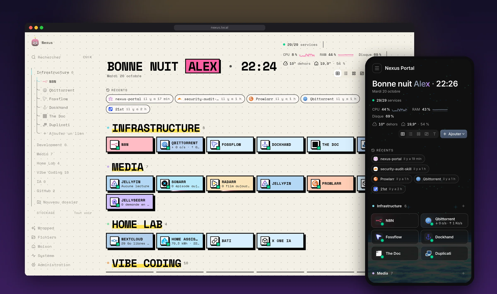
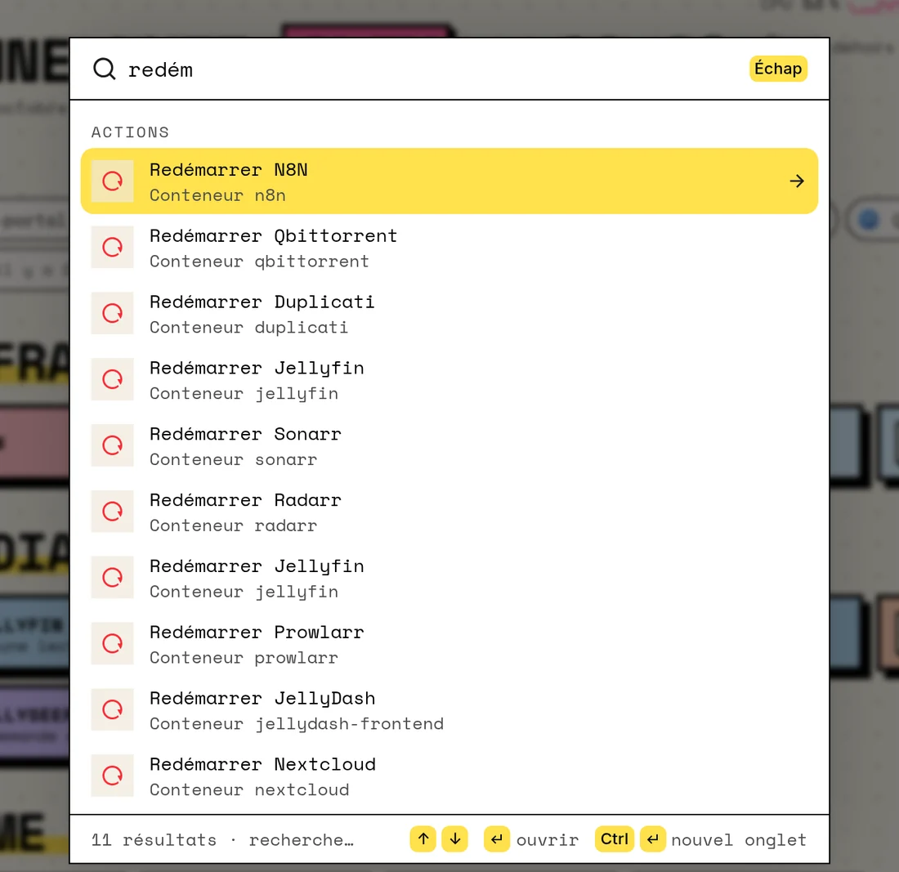
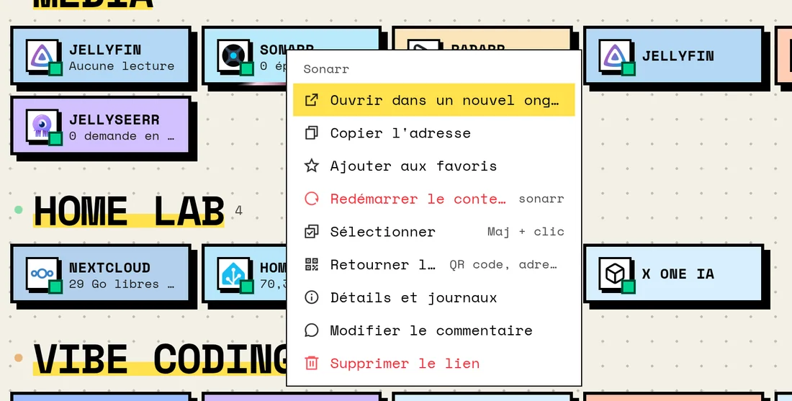
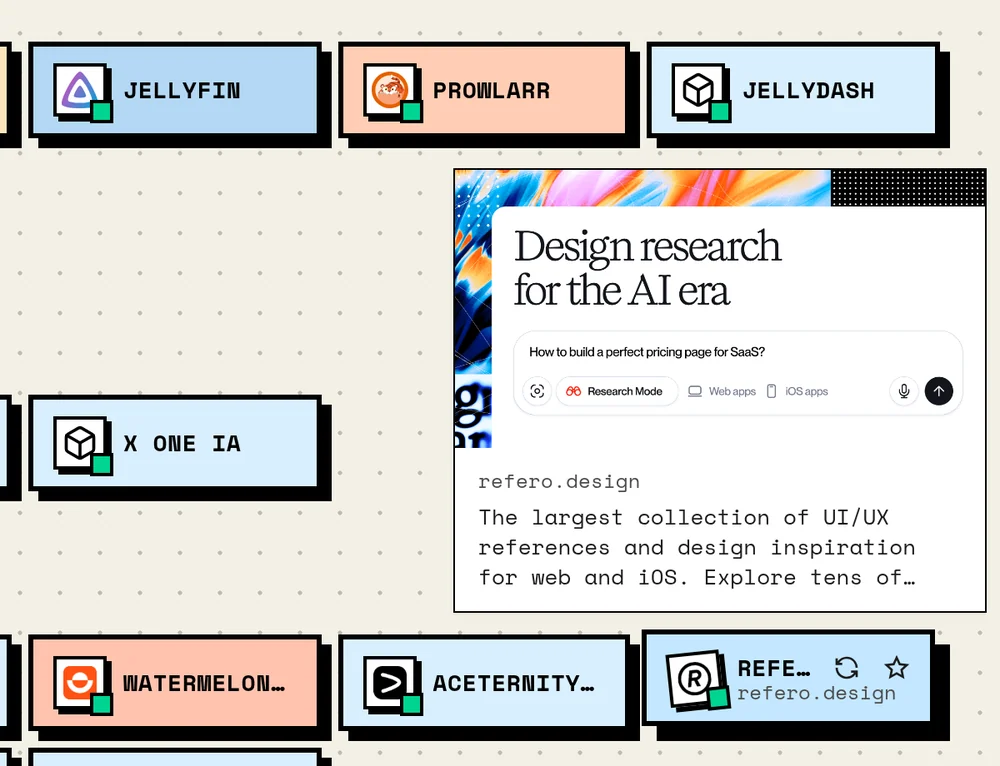
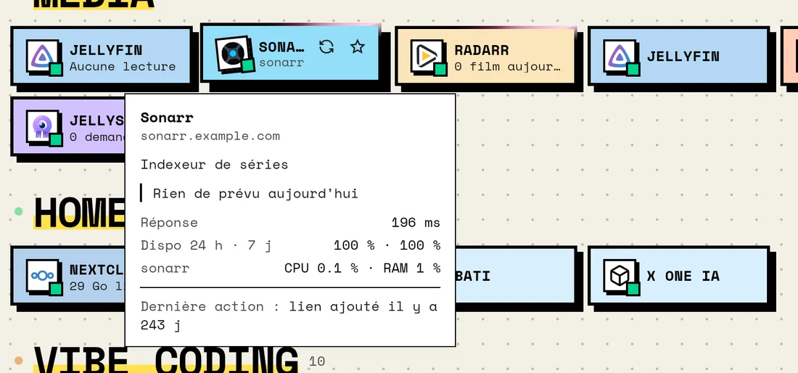
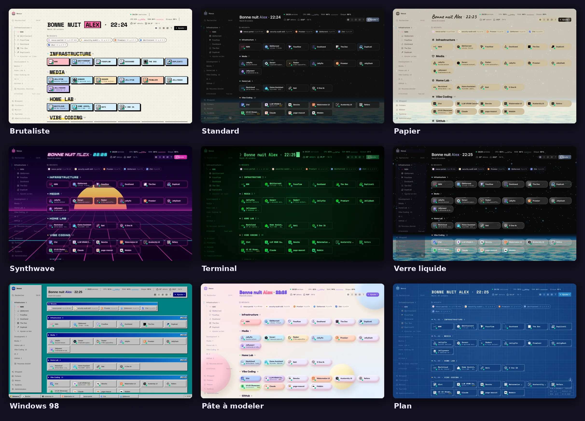
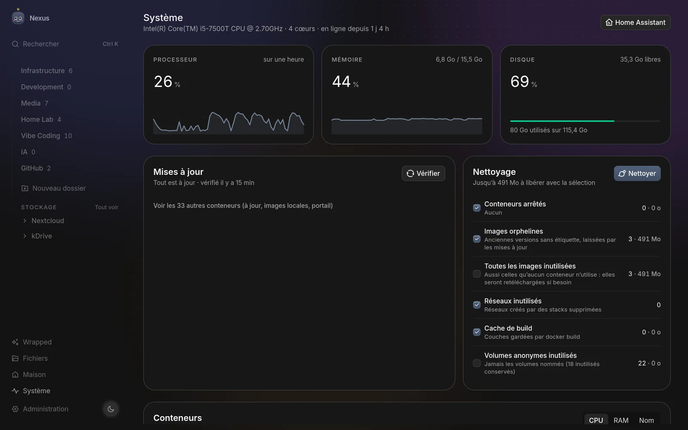
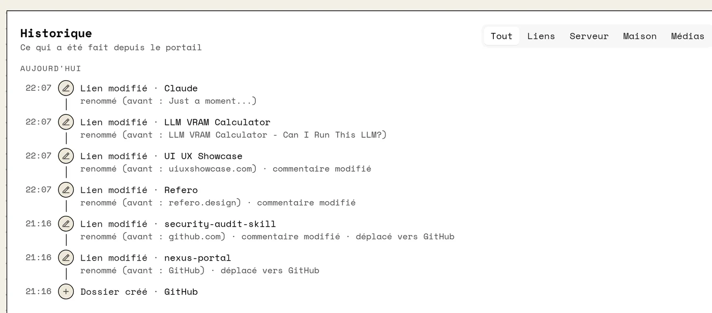
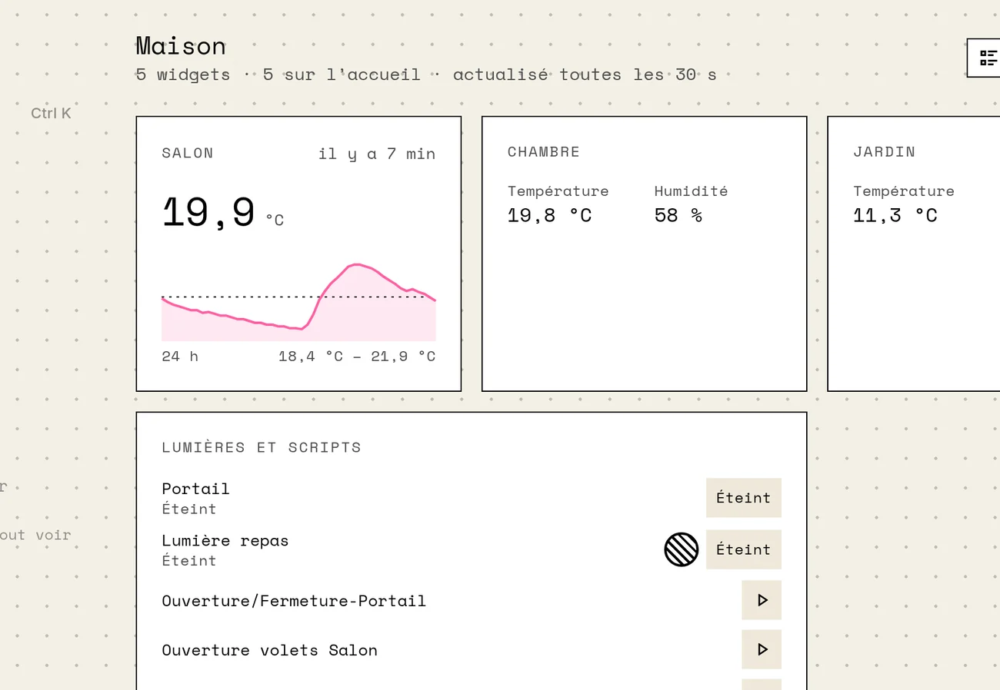
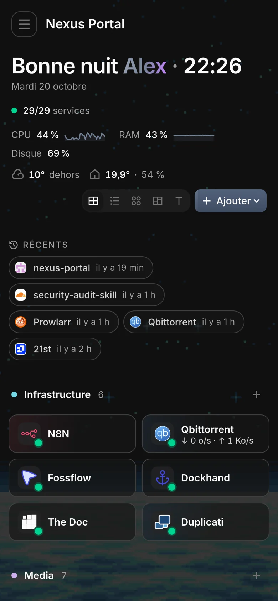

<div align="center">

# Nexus Portal

**The home page your homelab deserves.**
Every link, every service, every container — live, one keystroke away, and
dressed in the style you like.




[Quick start](#quick-start) · [Features](#features) · [Documentation](docs/README.md)

</div>

> The interface is in French. 🇫🇷

## Why Nexus

- **One place for everything** — your links in folders, your services with a
  live status, your server's CPU / RAM / disk, your Home Assistant sensors.
- **Fast like a launcher** — <kbd>Ctrl</kbd>+<kbd>K</kbd> opens links, restarts
  containers, requests a film, finds a file in Nextcloud.
- **It tells you what matters** — outages and recoveries pop up in a
  "Dynamic Island", slow services say so, dead links get flagged, and every
  action is written down in a history you can undo from.
- **It looks like *you*** — nine built-in styles, from brutalist to
  Windows 98, plus a studio to make your own.

## A quick tour

<table>
<tr>
<td width="50%" valign="top">

### <kbd>Ctrl</kbd>+<kbd>K</kbd> does it all
Links, folders, pages, container actions, Jellyseerr requests, Nextcloud and
kDrive files, web search — one palette, keyboard first.



</td>
<td width="50%" valign="top">

### Right-click anything
Open, copy, SSH, restart the container, flip the card for a QR code, write
a comment, delete in one click (with *Annuler* right after).



</td>
</tr>
<tr>
<td width="50%" valign="top">

### Hover a site, remember what it is
External links show the site's preview and description — no more
"what was *Refero* again?".



</td>
<td width="50%" valign="top">

### Hover a service, see how it's doing
Live lines, response time, uptime over 24 h and 7 days, the container's
CPU / RAM and the last action taken on it.



</td>
</tr>
</table>

### Nine styles, one click

Brutalist, Standard (light or dark, your accent colour), Paper, Synthwave,
Terminal (with a BIOS boot), Liquid glass, Windows 98 (taskbar and blue
screens for outages), Clay and Blueprint — or build your own in the style
studio and share it with a code.



### Your server, under control

Host and per-container CPU / RAM, start / stop / restart, image updates with
rollback, Docker cleanup — and a history of everything done from the portal,
with *Restaurer* for deleted links.





<table>
<tr>
<td width="62%" valign="top">

### Your home, next to your apps
Home Assistant widgets: a value with its 24 h curve, rooms, states, lights
(colour and brightness), scripts — on their own page and on the home page.



</td>
<td width="38%" valign="top">

### In your pocket
Installable as an app (PWA), made for the thumb.



</td>
</tr>
</table>

## Features

**Home page**
- Links grouped in folders (sidebar tree, drag and drop), several display styles
  (cards, list, icons, bento, text), favourites dock, recent links.
- Hover cards: site preview for external links; live data, uptime, container
  load and last action for your services.
- Right-click menu on tiles and sidebar links, with comments and one-click
  delete you can undo.
- GitHub repositories shown by repository and owner (with their avatar), in
  their own folder.
- Link check (on demand and daily): fills missing icons and descriptions,
  cleans address-only names, flags dead links.
- Status bar: services online, CPU / RAM / disk, weather — or your own Home
  Assistant sensors in its place.
- Health checks every 30 s with uptime history; outages and recoveries show in a
  "Dynamic Island" style notification; slow services say « lent ».
- Docker label discovery: containers labelled `nexus.name` / `nexus.url` get a
  tile automatically.
- Themes ("skins": paper, terminal, glass, blueprint, brutalist, synthwave,
  Windows 98, clay) and a style studio to make your own; lite mode for slower
  devices.

**Command palette (Ctrl K)**
- Links, folders, pages and actions (restart a container, SSH, theme…).
- Files from Nextcloud and kDrive, Jellyseerr requests (Enter twice to request a
  film or a series), web results through SearXNG.

**System**
- Host and per-container CPU / RAM, start / stop / restart.
- Image updates (pull + recreate, compose dependencies first, rollback on
  failure) and Docker cleanup.
- Action history: links, containers, updates, cleanups, Home Assistant
  commands, Nextcloud actions, Jellyseerr requests — deleted links can be
  restored from it.

**Integrations** (Admin → Intégrations; credentials stay on the server)

| Service | What you get |
| --- | --- |
| qBittorrent | Speeds, torrents in progress on its tile |
| Jellyfin | Who is watching what |
| Sonarr / Radarr | Today's releases, queue |
| Jellyseerr | Pending requests; search and request from Ctrl K |
| Nextcloud | Free space, activity, pending upgrade alert; files in Ctrl K; a few `occ` maintenance actions |
| kDrive (Infomaniak) | Free space; files in Ctrl K |
| Home Assistant | Sensors page, widgets (value + 24 h curve, rooms, states, controls incl. light colours), status bar readout |

**Files** — Nextcloud and kDrive side by side: a tree in the sidebar and a full
page with breadcrumb, sorting, search anywhere, new folders and uploads (drag and
drop, or the camera / photo library on a phone; 100 MB per file).

**Documentation:** [docs/](docs/README.md) — [getting started](docs/getting-started.md),
[user guide](docs/user-guide.md), [integrations](docs/integrations.md),
[Home Assistant](docs/home-assistant.md), [files](docs/files.md),
[security](docs/security.md), [troubleshooting](docs/troubleshooting.md).

## Quick start

Requirements: Docker with Compose.

```bash
git clone <this repository> nexus-portal && cd nexus-portal
cp .env.example .env                  # set DB_PASSWORD at least
cp backend/.env.example backend/.env  # optional: OpenWeather key
docker compose up -d --build
```

Then open `http://<server>` (nginx, port 80). The backend runs its database
migrations on start; a few example links are created the first time.

Ports used by default: 80 / 443 (nginx), 2443 (frontend dev server), 5010
(backend API), 5011 (Postgres). Change them in `docker-compose.yml` if needed.

## Configuration

| Variable (`.env`) | Purpose |
| --- | --- |
| `DB_PASSWORD` | Postgres password |
| `ALLOWED_HOSTS` | Public host names the frontend answers to (e.g. `.example.com`) |
| `CORS_ORIGINS` | The same addresses with their scheme, for API calls (e.g. `https://portal.example.com`) |
| `SEARXNG_URL` | SearXNG for web search in Ctrl K (optional) |
| `JELLYFIN_URL`, `JELLYFIN_API_KEY` | Legacy Jellyfin statistics routes (optional) |
| `OPENWEATHER_API_KEY` (`backend/.env`) | Weather in the status bar |

Everything else (integrations, your name for the greeting, SSH target, theme)
is set from the Admin page.

**Integration tips**
- Use LAN addresses (`http://192.168.1.10:8096`): a public subdomain behind an
  access proxy (Cloudflare Access, Authelia…) answers API calls with its login
  page.
- Nextcloud: create an app password (Personal settings → Security). For the
  server figures, set a token for the serverinfo app:
  `occ config:app:set serverinfo token --value <token>`.
- kDrive: create an API token with the *drive* scope in the Infomaniak Manager;
  the drive number is the one after `/drive/` in its web address. Nothing can
  be added at the drive's root, only inside its folders (e.g. *Private*).
- SearXNG: add `json` to `search.formats` in its `settings.yml`, and let the
  backend reach it (same Docker network, see the commented `networks` block in
  `docker-compose.yml`).
- Uploads above 100 MB are refused (Cloudflare's free-plan limit per request);
  raise `MAX_UPLOAD` in `backend/src/routes/integrations.ts` and
  `lib/storage.ts`, and `client_max_body_size` in `nginx.conf`, if you don't go
  through such a proxy.

## Security

- **There is no login.** The portal is meant for a trusted network or to sit
  behind an authenticating proxy (Cloudflare Access, Authelia, Authentik…).
  Do not expose it to the internet as is.
- The backend mounts the Docker socket (`/var/run/docker.sock`) to show,
  restart and update containers: whoever can use the portal can control your
  containers.
- Integration secrets are stored in Postgres and never sent to the browser.

## Development

The frontend is React + Vite + Tailwind CSS 4 (`App.tsx`, `pages/`,
`components/`, `styles/`); the backend is Express + Knex + Postgres
(`backend/src/routes`, `backend/src/services`, `backend/src/migrations`).

```bash
npm install && npm run dev                      # frontend on :3000
cd backend && npm install && npm run dev        # API on :5000 (needs Postgres)
```

In Docker the frontend runs Vite's dev server with the sources mounted (changes
apply live); the backend is compiled on start, so restart it after changing
its code: `docker compose up -d --build backend`.

`backup-portail.sh` / `restore-portail.sh` dump and restore the portal's
database into `backups/` next to them.
