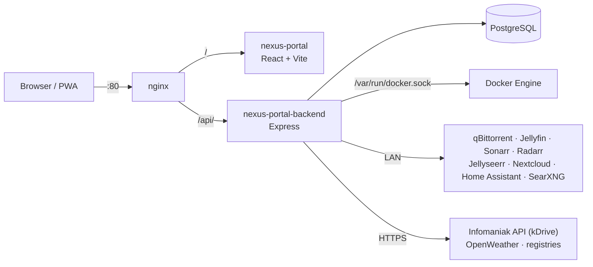

# Architecture

## Overview

- **nginx** is the single entry point: the app on `/`, the API on `/api/`
  (with unbuffered routes for server-sent events and uploads).
- **Frontend**: a React single-page app served by Vite's dev server, sources
  mounted from the host. It calls the API on the same origin.
- **Backend**: Express + Knex. It owns every credential and every call to the
  outside; the browser never talks to your services directly.
- **PostgreSQL**: configuration and history. Live data (stats, widgets, update
  checks) is kept in memory and rebuilt within a minute after a restart.

## Background jobs (backend)

| Job | Every | Source |
| --- | --- | --- |
| Health checks of every link + container state | 30 s | `services/monitor.ts` |
| Hourly roll-up of uptime into daily figures (for *Wrapped*) | 1 h | `services/monitor.ts` |
| Host CPU / RAM / disk sample | 15 s | `routes/system.ts` |
| Per-container CPU / RAM / network sample | 30 s | `services/containers.ts` |
| Integration widgets (all enabled integrations) | 20 s | `routes/integrations.ts` |
| Docker label discovery | 60 s | `services/discovery.ts` |
| Image update check (registry digests) | 12 h (checked hourly) | `services/updates.ts` |
| The creature's XP | 5 min | `services/pet.ts` |

## Data model

| Table | Holds |
| --- | --- |
| `categories` | Folders: name, icon, colour, order |
| `services` | Links: name, address, description, folder, icon, tags, favourite, visibility, order, Docker binding (`stats`) |
| `theme_config` | One row: mode, accent, style, background, density, home widgets, greeting name, SSH target, weather city |
| `custom_skins` | Styles made in the studio |
| `integrations` | One row per integration: address, key, user, password, options (e.g. pinned Home Assistant sensors, status bar entities, kDrive number), tile |
| `ha_widgets` | Home Assistant widgets: type, title, entities, on the home page, size, position |
| `health_samples` | Check results, 7 days |
| `health_daily` | Daily uptime per service (kept) |
| `access_logs` | Which link was opened when (recent links, most used, *Wrapped*) |
| `audit_logs` | Changes made from the portal |
| `pet` | The creature: name, birth, XP, streaks |

Migrations live in `backend/src/migrations` and run when the backend starts
(`npm run init`).

## API reference

All routes are under `/api` and return JSON. There is no authentication (see
[Security](security.md)).

### Links, folders, appearance

| Route | Purpose |
| --- | --- |
| `GET/POST /services`, `GET/PUT/DELETE /services/:id`, `PUT /services/reorder` | Links |
| `GET /services/health`, `GET /services/live-status` | Check results and uptime strips |
| `GET /services/recent`, `POST /services/:id/access` | Recent links; log an opening |
| `GET/POST /categories`, `GET/PUT/DELETE /categories/:id`, `PUT /categories/reorder` | Folders |
| `GET/PUT /theme` | Appearance and home settings |
| `GET/POST /skins`, `PUT/DELETE /skins/:id` | Studio styles |
| `GET /links/preview?url=` | Title, description and icon of a page (quick add) |
| `GET /weather` | Weather for the status bar |
| `GET /wrapped?month=YYYY-MM` | The month's story |
| `GET/PUT /pet`, `POST /pet/pet` | The creature |
| `GET /audit/logs`, `GET /audit/stats`… | Change log |

### Server and Docker

| Route | Purpose |
| --- | --- |
| `GET /system/stats` | Host CPU / RAM / disk with the last hour |
| `GET /docker/overview`, `GET /docker/containers`, `GET /docker/topology` | Containers and their figures |
| `GET /docker/stats/stream`, `GET /docker/logs/stream/:id` | Server-sent events: live stats, logs |
| `POST /docker/:id/restart` · `/stop` · `/start` | Container actions |
| `GET /docker/updates`, `POST /docker/updates/check`, `POST /docker/updates/:name` | Image updates |
| `GET/POST /docker/prune` | Cleanup preview / run |
| `GET /docker/discovered` | Run the label discovery now |

### Integrations

| Route | Purpose |
| --- | --- |
| `GET /integrations`, `PUT /integrations/:type`, `DELETE /integrations/:type` | Configuration (no secrets returned) |
| `GET /integrations/widgets` | Live lines, keyed by tile |
| `GET /integrations/jellyseerr/search?q=`, `POST /integrations/jellyseerr/request` | Search, request |
| `GET /integrations/nextcloud/search?q=`, `GET /integrations/kdrive/search?q=` | Files for the palette |
| `GET/POST /integrations/nextcloud/action` | Last / new `occ` action |
| `GET /integrations/:store/tree?path=` (Nextcloud) `?dir=` (kDrive) | One folder level |
| `GET /integrations/:store/find?q=` | Search anywhere, with each result's folder |
| `POST /integrations/:store/folder` `{ target, name }` | New folder |
| `POST /integrations/:store/upload?target=&name=` (raw body) | Upload a file |
| `GET /integrations/homeassistant/entities`, `PUT /integrations/homeassistant/pinned` | Sensors page, tile pins |
| `GET /search/web?q=` | Web results through SearXNG |

### Home Assistant widgets

| Route | Purpose |
| --- | --- |
| `GET /ha/widgets` | Widgets with the live state of their entities and 24 h history |
| `POST /ha/widgets`, `PUT/DELETE /ha/widgets/:id`, `PUT /ha/widgets/order` | Manage widgets |
| `POST /ha/control` `{ entityId, action, brightness?, rgb?, kelvin? }` | Run a control (entity must be in a *Contrôles* widget) |
| `GET/PUT /ha/statusbar` | Status bar entities |
